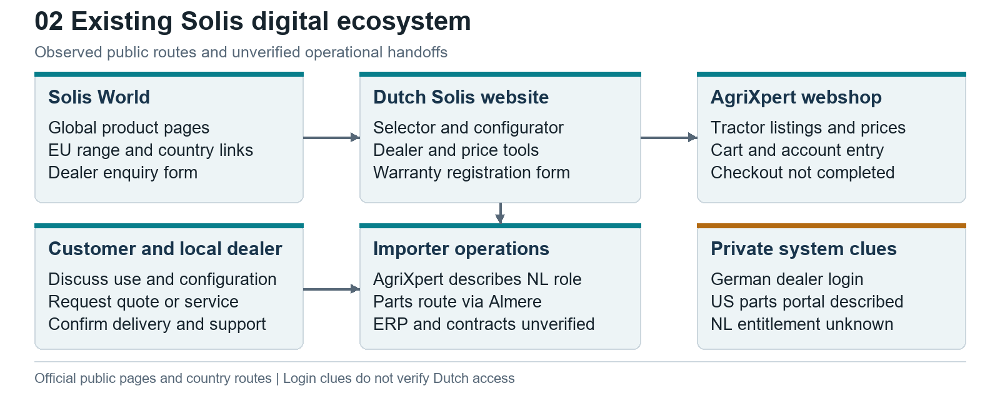
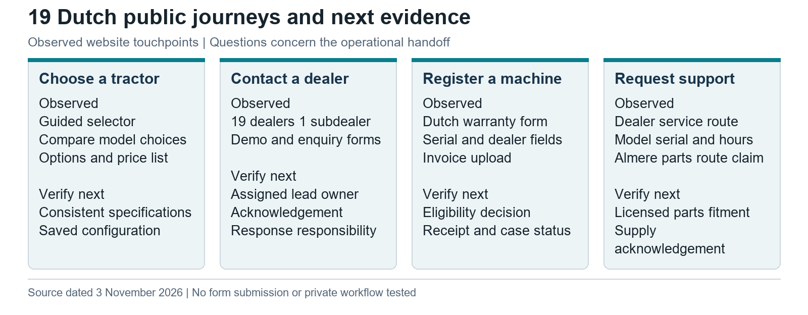

# Solis Netherlands Website Research

Prepared for Raja and company leadership. Public evidence checked 3 November 2026.

The material conclusion is that Solis has a distributed digital estate with significant public capability. Gaps in public visibility should become demonstration requests, not statements that systems do not exist.

### Dutch website findings and their business implications

The Netherlands website is an operating customer touchpoint, not simply a brochure. The public journey combines model discovery, requirements filtering, comparison, indicative configuration prices, regional dealers, demonstration requests and warranty intake. The refresh corrects the earlier audit's incomplete comparison and Dutch registration coverage. It verifies public presence, while leaving transaction delivery and private workflows separate. [I31](https://www.solistractor.nl/garantieformulier/), [I38](https://www.solistractor.nl/dealers/), [B26](https://www.solistractor.nl/vergelijken/?modellen%5B%5D=s26&modellen%5B%5D=h26), [B27](https://www.solistractor.nl/modellen/s26/)

**Network scope.** The site lists 19 dealers and one subdealer, consistent with the homepage's 20 sales/service points. Romox is identified under van Vijfeijken, without its own tractor stock. This is a published roster, not proof of 20 independent dealer contracts. Proposed lead routing and account permissions must support that main-dealer/subdealer relationship. Confirm the active contractual roster and service authority before provisioning accounts. [I38](https://www.solistractor.nl/dealers/), [I39](https://www.solistractor.nl/)

**Tractor discovery and comparison.** The selector was followed through loading, repeated forward/reverse and width choices. A narrower-than-one-metre branch returned models whose parsed widths were 0 cm; a second branch showed a heading/card-count discrepancy. These are reproducible page-data flags, not measured tractor widths. Unknown dimensions should require confirmation before a model is represented as meeting a physical constraint. The actual S26/H26 comparison table now loads and includes technical categories and explicit missing-value labels. Previous comparison timeouts must not be described as an absent capability. [B26](https://www.solistractor.nl/vergelijken/?modellen%5B%5D=s26&modellen%5B%5D=h26), [B25](https://www.solistractor.nl/keuzehulp/?situation=laden&transmission=shuttle&width=100)

**Configuration and enquiries.** The S26 page exposes options and dependency guidance with indicative prices and dealer-selected enquiry. The fresh check also inspects demonstration intake. Form presence, fields and source model context can be verified; acknowledgement, received configuration, assignment, response times and CRM integration require a controlled test. Public contact routes do not demonstrate manual back-office work. [I08](https://www.solistractor.nl/modellen/s26/), [B28](https://www.solistractor.nl/demonstratie/?model=s26), [B27](https://www.solistractor.nl/modellen/s26/)

**Demonstration content defect.** The public demonstration page displays unfinished instructions asking for a follow-up owner, response timing and commercial conditions. This leaves the next step unclear to a customer. The importer should replace that text with an agreed service promise and test a received request through its responsible dealer. The finding concerns published content; no failed delivery is alleged. [B28](https://www.solistractor.nl/demonstratie/?model=s26)

**Prices and commercial authority.** The S50 promotion page publishes EUR 21,725 for the tractor, EUR 4,995 for the loader and EUR 650 for mounting, totalling EUR 27,370 excluding VAT. It explicitly leaves the promotion's active period for dealer confirmation. These are indicative retail amounts, not turnover, dealer margin or a binding current quote. A future assistant or quote draft must retain price-list version, included options, installation, tax, validity and commercial approval. [M12](https://www.solistractor.nl/acties/), [I18](https://www.solistractor.nl/wp-content/uploads/2026/08/Solis-prijslijst.pdf)

**After-sales and existing registration.** Dutch service directs owners to dealers with machine identity and hours. Warranty and service pages lead to a Dutch registration form with owner, dealer, serial, purchase and invoice evidence. Registration intake is verified; processing, activation and a complete machine history remain unknown. Reuse this route before building another form, and ask the warranty owner to demonstrate acknowledgement and exception handling. The displayed lookup and photo-deletion descriptions do not establish extraction accuracy or actual deletion. [I31](https://www.solistractor.nl/garantieformulier/), [I32](https://www.solistractor.nl/garantie/), [I33](https://www.solistractor.nl/klantenservice/)

**Importer commerce and shared data.** AgriXpert offers a separate tractor purchase route. The refresh identifies differing S16 lifting/width descriptions across Dutch discovery and importer content; configuration or revision differences may explain them and must be checked. Do not choose an authoritative value by guesswork. Identify a market/model/variant master and feed consistent facts into selector, comparison, configuration, shop and future assistant. [I09](https://www.agrixpert.com/solis-16-4wd), [B35](https://www.agrixpert.com/solis-16-4wd)

### Capability audit across public surfaces

| Capability | Status | Scope and evidence |
|---|---|---|
| Global and EU catalogues | Verified present | Solis World ranges and country links [I06](https://solisworld.com/) |
| Model specifications | Verified present | Global and Dutch S26 pages [I08](https://www.solistractor.nl/modellen/s26/), [I26](https://solisworld.com/solis-s26-compact-tractor/) |
| Model selector | Verified present | Dutch guided flow followed [I07](https://www.solistractor.nl/keuzehulp/), [I17](https://www.solistractor.nl/keuzehulp/?situation=laden&transmission=shuttle&width=any) |
| Configurator | Verified present | S26 options and dependency guidance [I08](https://www.solistractor.nl/modellen/s26/); recalculation not independently tested |
| Indicative prices and price list | Verified present | Dated PDF and importer listings [I09](https://www.agrixpert.com/solis-16-4wd), [I18](https://www.solistractor.nl/wp-content/uploads/2026/08/Solis-prijslijst.pdf) |
| Tractor comparison | Verified present | Actual S26/H26 comparison table inspected; earlier timeout limitation superseded [B26](https://www.solistractor.nl/vergelijken/?modellen%5B%5D=s26&modellen%5B%5D=h26) |
| Dealer locator and dealer information | Verified present | 19 dealers and one subdealer; published roster and relationship [I38](https://www.solistractor.nl/dealers/), [I39](https://www.solistractor.nl/) |
| Stock labels | Verified present | Importer product and generic locator labels [I09](https://www.agrixpert.com/solis-16-4wd), [I15](https://www.solistractor.nl/dealers/) |
| Real-time dealer inventory | Unclear / requires direct confirmation | Quantity, refresh and reservation semantics not established |
| Enquiries quote and demo requests | Verified present | Dealer-selected forms; response and delivery untested [I08](https://www.solistractor.nl/modellen/s26/), [B28](https://www.solistractor.nl/demonstratie/?model=s26), [B27](https://www.solistractor.nl/modellen/s26/) |
| Automated lead routing | Unclear / requires direct confirmation | Delivery, CRM and service levels not tested |
| Saved or shared configurations | Unclear / requires direct confirmation | Comparison selection persistence is described; full configuration sharing and dealer transfer remain unverified [B26](https://www.solistractor.nl/vergelijken/?modellen%5B%5D=s26&modellen%5B%5D=h26), [B27](https://www.solistractor.nl/modellen/s26/) |
| Dealer interest application | Verified present | Global form and Dutch contact route [I02](https://solisworld.com/become-a-dealer/), [I23](https://www.solistractor.nl/contact/?onderwerp=dealer) |
| Automated onboarding | Not publicly discoverable | Approvals, contracts, certification and provisioning not exposed |
| Tractor cart and purchase entry | Verified present | AgriXpert configurable listings [I09](https://www.agrixpert.com/solis-16-4wd), [I19](https://www.agrixpert.com/tractoren/tractoren/solis) |
| Completed checkout and fulfilment | Partially verified | Entry found; no transaction performed |
| Implements and attachments | Verified present | Product options and public listings [I06](https://solisworld.com/), [I08](https://www.solistractor.nl/modellen/s26/), [I19](https://www.agrixpert.com/tractoren/tractoren/solis) |
| Serial-linked electronic parts catalogue | Not publicly discoverable | No public NL/global catalogue journey verified |
| Exploded parts diagrams | Not publicly discoverable | Private or licensed catalogue cannot be excluded |
| Parts order and fulfilment | Partially verified | Dealer/distribution descriptions; US portal claim [I20](https://www.solistractor.nl/klantenservice/), [I21](https://www.solistractor.nl/informatie/), [M10](https://solistractorusa.com/content/sportsman/service.php) |
| Service booking | Partially verified | Dealer contact route; no calendar booking established [I20](https://www.solistractor.nl/klantenservice/) |
| Warranty policy | Verified present | Netherlands policy page [I25](https://www.solistractor.nl/garantie/) |
| Warranty registration intake | Verified present | Dutch owner dealer machine and invoice form; processing not tested [I31](https://www.solistractor.nl/garantieformulier/), [I32](https://www.solistractor.nl/garantie/) |
| Warranty claims processing | Unclear / requires direct confirmation | No private claim workflow inspected |
| Machine registration intake | Verified present | Public Dutch warranty form collects machine identity [I31](https://www.solistractor.nl/garantieformulier/) |
| Machine ledger and service history | Unclear / requires direct confirmation | Public intake does not establish an accessible machine record or history |
| Dealer-only login entry | Verified present | Germany; Romania DMS/IBIZ links [I10](https://www.solis-traktor.de/haendlerlogin), [I11](https://tractoarelesolis.ro/) |
| Dutch dealer portal functions | Unclear / requires direct confirmation | Authorised walkthrough needed |
| Customer support | Verified present | Public dealer, phone and email routes [I20](https://www.solistractor.nl/klantenservice/) |
| Brochures and price documents | Verified present | Public model/document links [I18](https://www.solistractor.nl/wp-content/uploads/2026/08/Solis-prijslijst.pdf), [I21](https://www.solistractor.nl/informatie/), [I26](https://solisworld.com/solis-s26-compact-tractor/) |
| Workshop and operator manual coverage | Unclear / requires direct confirmation | Download centre content required sign-in |
| Supported public API | Not publicly discoverable | No documented catalogue, stock or order API established |

### Priority actions from the Dutch audit

These priorities are analyst recommendations based on the public evidence. Priority describes the order of validation and correction, not a quantified return or an agreed delivery schedule.

| Priority and finding | Recommended action and proposed owner | Evidence required to close |
|---|---|---|
| First Demo follow-up copy remains unfinished [B28](https://www.solistractor.nl/demonstratie/?model=s26) | Importer sales and website owner agree recipient, acknowledgement and response responsibility | Approved copy plus an authorised test received by the correct person |
| First Selector accepts zero-width records [B25](https://www.solistractor.nl/keuzehulp/?situation=laden&transmission=shuttle&width=100) | Product data owner tests width filters and prevents unknown dimensions from implying fit | A reviewed test set with known widths and unknown-value cases |
| First Warranty guidance has unresolved conditions [I31](https://www.solistractor.nl/garantieformulier/), [I32](https://www.solistractor.nl/garantie/) | Warranty owner separates intake, provisional registration, extension approval and claims | Confirmed policy and tests for no plate, missing evidence and correction |
| Next Specifications differ across channels [B35](https://www.agrixpert.com/solis-16-4wd) | Product and commerce owners reconcile variant and source revisions | Signed-off data record used consistently by discovery and shop |
| Next Current pricing and supply need authority [M12](https://www.solistractor.nl/acties/), [I38](https://www.solistractor.nl/dealers/) | Commercial and parts owners define validity, stock timestamps and dealer entitlements | One approved quote and one acknowledged parts request traced to source |

The warranty form says an owner may leave the licence plate blank while the extension page describes a valid Dutch plate condition. These may concern different stages; the distinction needs clarification rather than an assumed rejection rule. The form also describes HEIC uploads while its public file-input acceptance list differs. Confirm supported formats through an authorised acceptance test. Neither observation proves that submitted registrations fail. [I31](https://www.solistractor.nl/garantieformulier/), [I32](https://www.solistractor.nl/garantie/)

### Consequences for the four workstreams

| Workstream | Dutch evidence changes the proposed scope | First demonstration to request |
|---|---|---|
| Dealer Portal | Reuse public enquiry demo and registration routes; show their next action in one workspace | Follow a consented enquiry from model selection to dealer receipt and response |
| Parts Intelligence | Dealer-assisted identification and Almere route are published; catalogue access is still a dependency | Trace a real serial to an approved part and supply acknowledgement |
| Agentic Commerce | Selector comparison options and prices already provide discovery; data quality must be resolved before AI advice | Answer reviewed tasks with model variant sources unknown values and dealer escalation |
| Dealer Onboarding | Public dealer-interest intake exists; main/subdealer roles need distinct entitlements | Show one applicant through agreement training first-order access and suspension |

**Interpretation.** A configured form and an ecommerce cart solve only parts of the lifecycle. The strongest next question is whether the chosen dealer receives structured requirements, a reproducible configuration and an accountable next action. That question must be answered by a controlled test and private-system walkthrough.

